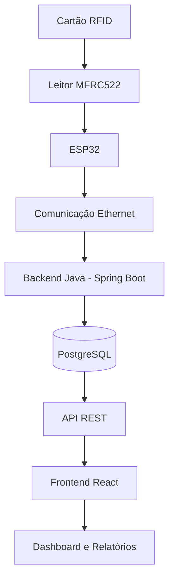

# 🎓 EduControl — Secretaria Inteligente

\<p align="center">   \<strong>Uma solução inteligente para modernizar a gestão escolar.\</strong>   \<br />   Automatizando processos, organizando informações e transformando dados em decisões. \</p>

\<p align="center">   \   \   \   \   \ \</p>

---

## 📌 Sobre o projeto

O **EduControl** é um sistema de gestão escolar desenvolvido como Trabalho de Conclusão de Curso (TCC), com o objetivo de modernizar e facilitar os processos administrativos de instituições de ensino.

A plataforma reúne funcionalidades para gerenciamento de alunos, controle de frequência, organização de turmas, relatórios e acompanhamento de informações escolares.

O projeto também integra tecnologias de identificação por RFID e comunicação via ESP32, permitindo automatizar o registro de presença dos estudantes.

Além disso, conta com uma proposta de Secretaria Inteligente, utilizando inteligência artificial para auxiliar na consulta e interpretação de informações do ambiente escolar.

## 🚀 Funcionalidades

- 📊 **Dashboard:** visão geral das informações e indicadores escolares.
- 👨‍🎓 **Gestão de alunos:** cadastro, consulta, edição e organização dos estudantes.
- 🏫 **Gestão de salas:** gerenciamento de turmas e salas de aula.
- 📡 **Controle de presença:** integração com tecnologia RFID para registro de frequência.
- 📈 **Relatórios:** visualização de dados e indicadores de frequência.
- 🤖 **Inteligência Artificial:** assistente virtual para auxiliar nas atividades da secretaria.
- 👥 **Equipe:** gerenciamento de usuários e permissões.
- 🔐 **Autenticação:** sistema de login e controle de acesso.
- ⚙️ **Configurações:** personalização das preferências do sistema.
- 📝 **Logs:** acompanhamento de atividades realizadas na plataforma.

## 🛠️ Tecnologias utilizadas

### Frontend

- React
- TypeScript
- Tailwind CSS
- React Router
- Framer Motion
- Recharts
- Lucide React

### Backend

- Java 21
- Spring Boot
- Maven
- Spring Data JPA
- Spring Security

### Banco de dados

- PostgreSQL
- Flyway

### Hardware e comunicação

- ESP32
- RFID MFRC522
- Módulo Ethernet ENC28J60
- Comunicação SPI
- Python para testes e comunicação com hardware

### Ferramentas

- Visual Studio Code
- IntelliJ IDEA
- Git e GitHub
- Docker
- Postman

## 🏗️ Arquitetura do projeto

O EduControl utiliza uma arquitetura integrada, conectando hardware, backend, banco de dados e interface web.



### Fluxo de funcionamento

1. O estudante aproxima seu cartão RFID do leitor.
2. O ESP32 identifica o cartão.
3. As informações são encaminhadas pela comunicação Ethernet.
4. O backend processa o registro de frequência.
5. Os dados são armazenados no PostgreSQL.
6. O frontend consome a API e apresenta as informações atualizadas.

## 📂 Estrutura do projeto

```text
EduControl/
│
├── front_sanico/
│   ├── src/
│   ├── public/
│   ├── package.json
│   └── ...
│
├── backend/
│   ├── src/
│   ├── pom.xml
│   └── ...
│
├── hardware/
│   ├── testes/
│   └── ...
│
├── README.md
└── .gitignore
```

*Estrutura ilustrativa. Os diretórios podem variar conforme a organização atual do repositório.*

## ⚙️ Como executar o projeto

### Pré-requisitos

- Node.js 20 ou superior
- Java 21
- Maven 3.9 ou superior
- PostgreSQL
- Git

### 1. Clone o repositório

```bash
git clone URL_DO_SEU_REPOSITORIO
```

### 2. Acesse o projeto

```bash
cd NOME_DO_PROJETO
```

### 3. Configure o banco de dados

Crie um banco PostgreSQL e configure as credenciais de conexão nas variáveis de ambiente do backend.

### 4. Execute o backend

```bash
mvn spring-boot:run
```

### 5. Execute o frontend

Entre na pasta do frontend:

```bash
npm install
npm run dev
```

Após iniciar, acesse o endereço disponibilizado pelo Vite, normalmente:

```text
http://localhost:5173
```

## 🔒 Segurança

O projeto considera boas práticas de segurança e organização de dados, incluindo:

- Autenticação de usuários.
- Proteção de informações.
- Variáveis de ambiente para configurações sensíveis.
- Organização de permissões e perfis de acesso.
- Cuidados relacionados à Lei Geral de Proteção de Dados (LGPD).

**Importante:** arquivos `.env`, senhas, tokens e credenciais não devem ser enviados ao repositório público.

## 🗺️ Desenvolvimento

O EduControl está em desenvolvimento e passa por etapas de implementação, integração e testes.

- [x] Desenvolvimento da interface principal.
- [x] Estrutura de navegação e sidebar.
- [x] Sistema de autenticação inicial.
- [x] Desenvolvimento do módulo de alunos.
- [x] Desenvolvimento do módulo de salas.
- [x] Estrutura inicial do backend.
- [x] Configuração do PostgreSQL.
- [x] Testes iniciais do módulo RFID.
- [x] Testes de comunicação Ethernet.
- [ ] Integração completa entre frontend e backend.
- [ ] Integração completa do hardware com o sistema.
- [ ] Testes gerais de funcionamento.
- [ ] Finalização e apresentação do projeto.

## 🎯 Objetivo

O objetivo do EduControl é demonstrar como a tecnologia pode contribuir para uma gestão escolar mais eficiente, conectada e acessível.

Mais do que um sistema de cadastro, a proposta é construir uma plataforma capaz de integrar automação, desenvolvimento de software, banco de dados e inteligência artificial em um único ambiente.

---

\<p align="center">
&#x20; \<strong>🎓 EduControl — Secretaria Inteligente\</strong>
&#x20; \<br />
&#x20; \<em>Tecnologia conectando pessoas, dados e educação.\</em>
&#x20; \<br />\<br />
&#x20; Desenvolvido como projeto acadêmico de TCC.
\</p>
